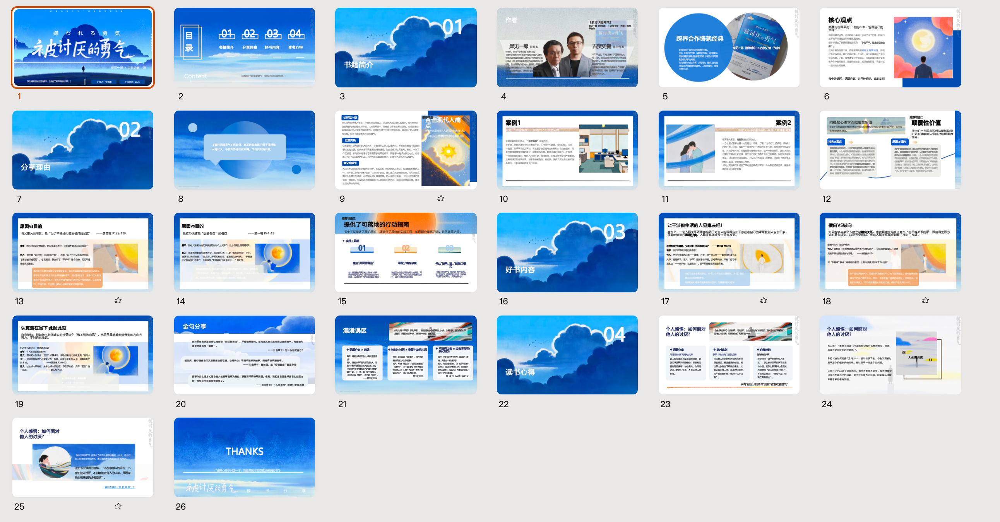
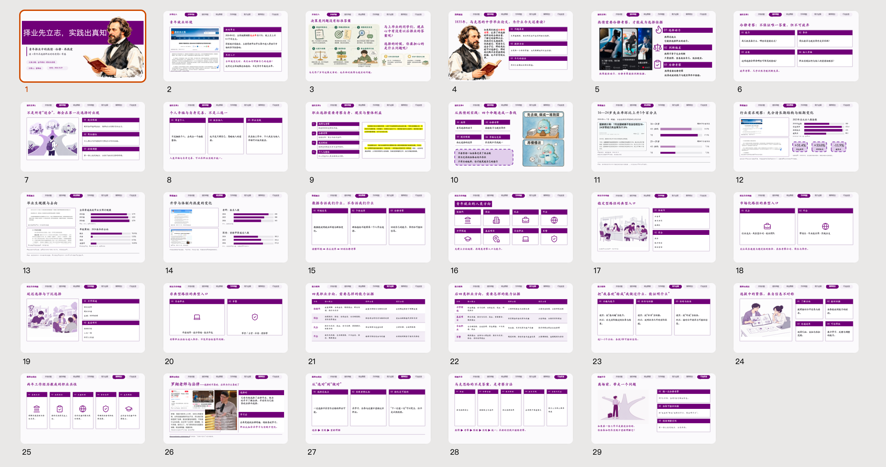

本仓库收录了我在大学本科期间参与读书分享活动时制作的一些资料，以及准备过程中产生的思考与感悟。如果有需要相关 PPT 资料的同学，可以自行下载使用。

> **关于《云上书屋读书会》**
>
> 《云上书屋读书会》是由云南大学软件学院组织管理的一个读书分享项目，官方微信公众号为「琦心软语」。该项目创办于 2022 年 4 月（官方公众号的注册时间），旨在调动同学们阅读与分享的积极性。每学年，项目都会围绕不同主题，通过书籍选择、领读人选拔以及领读人分享等环节开展读书活动。

## 我的读书分享记录


| 时间 | 分享书籍 | 相关资料 | 制作工作流 |
|---|---|---|---|
| 大二下 | 《被讨厌的勇气》 |  | 购买的 PPT 模板 + 自己修改 |
| 大三上（2026 年） | 《青年在选择职业时的考虑》——马克思 |  | 使用 [Guizang PPT Skill](https://github.com/op7418/guizang-ppt-skill) + [HTML2PPT Skill](https://github.com/XiNian-dada/PPTskills/tree/main/html2ppt/html2ppt) |


# 关于 AI 时代重塑 Pre 工作流的一些个人思考

过去，我制作 PPT 的工作流程大致如下：

首先进行 *Brainstorm（头脑风暴）*，搜集观点和 Idea，并将它们记录在文档中；随后根据文档制作思维导图，梳理 PPT 大纲。与此同时，我还会在各大社交媒体平台上寻找风格合适的 PPT 模板。等到内容框架和模板都准备好之后，再正式开始制作 PPT。

用流程图表示，大致是：

```text
Brainstorm，搜集观点与 Idea
          ↓
      整理文档
          ↓
  制作思维导图，梳理 PPT 大纲 ──┐
                              ├──→ 开始制作 PPT
  在社交媒体寻找合适的 PPT 模板 ──┘
```

这个流程虽然繁琐，从信息搜集、观点整理到最终制作，几乎所有环节都需要自己亲手完成，但也正因为如此，我对每一步都有着比较深刻的印象。

而到了 AI 时代，PPT 的制作范式似乎发生了变化：

```text
打开 ChatBox
    ↓
告诉 AI：
“你是一名【领域】专家，
擅长【技能】，
请为我制作一份关于【主题】的 PPT。”
    ↓
Loop（与 AI 对话 → 人工修改 → 继续对话）
```

整个流程看起来简化了不少，但实际操作时，你会发现，时间往往在 Loop 阶段不知不觉地流逝了。你不断与 AI 对话、调整需求、修改结果，再继续与 AI 对话，仿佛进入了一个 `while (True)` 的死循环。

看似省去了很多步骤，实际上，这个过程同样相当耗费时间和精力。

那么，在 AI 时代，我们究竟应该如何平衡自己与 AI 之间的分工呢？

围绕 PPT 制作这件事，下面是我的一些个人思考与建议。

## 一、AI 时代，一定要养成自己的输出型爱好

“养成自己的输出型爱好”这个观点，其实已经有很多人提到过。

但为什么在 AI 时代，个人的“输出型爱好”会显得尤为重要呢？

大家应该都知道，LLM 的基本工作机制之一是根据上下文预测后续 Token。这种概率性的生成机制，意味着 AI 的输出始终存在出错的风险。

而且，现在的 AI 往往有这样一个特点：如果你不对它的输出范围加以限制，它就可能尽可能多地搜集、整理和生成相关内容，一股脑地呈现给你。

大家应该都有过类似的感受：

当你面对大量文本信息时，很容易下意识地产生一种偷懒的心理：

“AI 都已经生成这么多内容了，不管怎么说，工作量应该是够了吧？那我就不再仔细检查，直接提交好了。”

但如果你真的抱着这种心态，后续的工作任务反而可能变得更加繁重。

因为，如果你不对 AI 生成的内容进行审查和验证，它就可能在不知不觉中给你埋下很多“大雷”。这些问题在生成内容的当下或许并不明显，却可能在后续使用过程中逐渐暴露出来。

而我认为，**输出型爱好恰恰能够帮助我们训练静下心来思考、梳理观点和审查信息的能力。**

这并不完全是一种主观感受，也有一些相关研究可以提供参考。

例如， *Guo（2023）* 发表在 *British Journal of Clinical Psychology* 上的一项元分析，汇总了 31 项随机对照实验、共 4,012 名参与者的数据。研究发现，表达性写作对缓解抑郁、焦虑和压力症状具有较小但具有统计学意义的积极作用，而且这种作用可能在一段时间后才逐渐显现。

这项研究虽然不能直接证明“写日记可以提升信息审查能力”，但至少说明，持续进行主动的书面表达，在某些心理健康指标上可能具有积极价值。

> **参考文献：** Guo, L. (2023). *The delayed, durable effect of expressive writing on depression, anxiety and stress: A meta-analytic review of studies with long-term follow-ups.* British Journal of Clinical Psychology, 62(1), 272–297. [https://doi.org/10.1111/bjc.12408](https://doi.org/10.1111/bjc.12408)

事实上，输出型爱好有很多种形式，例如写日记、读书分享、写博客，或者定期整理自己的学习心得。

你不必因为觉得自己还不够优秀、对某个领域的理解还不够深刻，就认为自己没有资格发表观点。

同样，也不要过于担心别人不赞同你的看法。

在交流和讨论的过程中，观点之间产生分歧与摩擦是很正常的事情。不要害怕这些摩擦，因为很多时候，**恰恰是这些摩擦，推动着我们的认知不断进步。**

## 二、与 AI 对话后，在每个阶段生成文档记录，再根据文档重新整理一份自己的笔记，不要直接照搬 AI 的输出

这个观点同样有一些相关的学习理论和研究可以作为参考。

例如，有一种笔记方法叫作“卢曼卡片笔记法”（Zettelkasten）。

按照我的理解，它的核心思想大致是：

**不要只做观点的搬运工，而是要让别人的观点经过自己大脑的理解、加工和转译，最终变成真正属于自己的知识。**

在这个过程中，我们可以把临时捕捉到的想法记录为**灵感笔记**_（观点来源：卢曼卡片学习法）_，再将那些经过思考、值得长期保留的内容整理为**永久笔记**。对于已经完成整理、失去继续保留价值的临时记&#x5F55;*（这些都是灵感笔记）*，则可以适当清理，避免给自己增加不必要的信息负担。

其实，“卢曼卡片笔记法”这个概念，我很早之前就听说过。

但当我这次重新引用它时，已经记不清其中的很多具体细节了。

不过，对我而言，它最值得记住的核心思想可以浓缩成一句话：

**“不要做搬运工，复述才是大脑的刻刀。”**

这句话是我在接触、理解了许多相关观点之后，最终提炼出来，希望能够长期留在自己脑海中的东西。

关于这一点，相关学习研究中也存在一些值得参考的发现。

例如，*Mueller* 和 *Oppenheimer（2014）* 在 *Psychological Science* 上发表的一项研究指出，相较于机械地逐字记录，使用自己的语言理解、组织和改写信息，可能更有利于学习。需要注意的是，该研究关于手写笔记优势的部分结论在后续重复研究中并未得到完全一致的支持，但“主动加工信息，而非单纯照搬”的思路仍然值得借鉴。

> **参考文献：** Mueller, P. A., & Oppenheimer, D. M. (2014). *The Pen Is Mightier Than the Keyboard: Advantages of Longhand Over Laptop Note Taking.* Psychological Science, 25(6), 1159–1168. [https://doi.org/10.1177/0956797614524581](https://doi.org/10.1177/0956797614524581)

而下面这段话，是我在撰写这一部分内容、搜索相关资料时偶然看到的。

当时，我发现了一款受到“卢曼卡片笔记法”思想启发的写作软件——“写匠”。它的创始人阳志平在一篇随笔中提到的观点，给我带来了很大的触动。


<p align="right">
  <em>——<a href="https://yangzhiping.com/essays/20260912/">阳志平 · 2026 年 9 月 12 日 · 随笔</a></em>
</p>

回到 AI 本身。

在我看来，AI 的存在，很大程度上是在帮助我们**把混乱的思想整理成有序的思想**。

它擅长搜集、整理和组织信息，也能够在已有信息的基础上生成新的表达与组合。但我始终认为，真正有价值的创造，不只是把已有内容重新组合起来，更重要的是人对问题的理解、判断，以及独立思考后所作出的选择。

很多时候，你可能只是简单地向 AI 描述了一句话，它就生成了一份看起来近乎完美的作品。

但这种“完美”，有时可能只是因为，在当下这个阶段，它所呈现出的知识广度和表达能力超出了你的认知范围。

等到未来某一天，你的见识更加丰富，认知水平也有所提升，再回过头去看那些曾经让你惊叹的作品——那些 AI 可能只用了不到半小时，而你自己却需要花费几天时间才能完成的东西——你也许就会发现，其中其实存在着不少漏洞。

**所以，我认为，AI 可以帮助我们更高效地整理和表达思想，但不能因此放弃独立思考，更不能把对内容的判断权完全交给 AI。**


